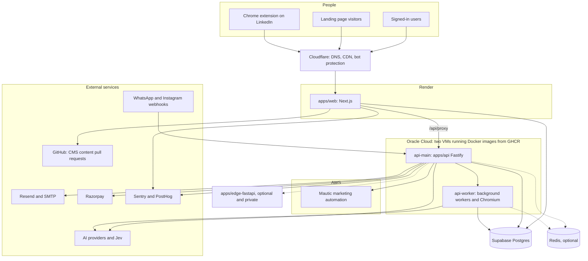

# CraftMyFunnel

CraftMyFunnel is a multi-app monorepo for AI-assisted outbound operations, landing-page funnels, buyer-signal review, and team governance. The repo ships three deployable services with shared contracts and shared operational docs.

## Current Status

The platform is live and in controlled beta. Open work, owner-side setup and known risks are tracked in [OPEN_ITEMS.md](./OPEN_ITEMS.md). Treat that file, the CI results on `main` and each service's `/health` endpoint as the source of truth, not dated snapshots in older documents.

## Monorepo Layout

| Path | Service | Role |
| --- | --- | --- |
| `apps/web` | Next.js app | Marketing pages, authenticated product UI, public landing pages, the CMS (`/cms`), selected route handlers |
| `apps/api` | Fastify app | Core API, background workers, Prisma access, webhooks, AI runtime integration, readiness checks |
| `apps/api/src/extension` | Chrome extension | LinkedIn assistant; see its own [README](./apps/api/src/extension/README.md) |
| `apps/edge-fastapi` | FastAPI edge runtime | Optional private execution service for edge or hardware-backed tasks |
| `packages/db` | Shared package | Shared database schema and client |
| `packages/toon-core` | Shared package | Shared serialization/helpers for AI context handling |
| `deploy/oracle` | Compose files | The API and worker containers on the Oracle VMs |
| `deploy/aws/mautic` | CloudFormation | The Mautic server on AWS |
| `.github/workflows` | CI/CD | Build, test, migrate and deploy pipelines |
| `docs/*` | Docs | Architecture, deployment, QA and implementation records (some are historical) |

## Runtime Topology



How a change reaches production:

| Service | Built by | Deployed by |
| --- | --- | --- |
| `apps/web` | `Web Build` in CI | `deploy-render.yml` (manual or six-hourly; Render auto-deploy is off) |
| `apps/api` | `docker-ghcr.yml` pushes an image to GHCR | `deploy-oracle.yml` on merge to `main` |
| Database schema | not built | `web-prisma-migrate.yml`, behind the `production-migrate` approval gate. Run it before a web deploy that needs a new migration. |

## What The Product Actually Does Today

The safe description is:

- helps teams manage outreach campaigns, leads, approvals, landing funnels, and setup
- ingests buyer-intent signals and turns them into review-ready follow-up context
- supports AI-assisted drafting and analysis with centralized guardrails and credit enforcement
- tracks landing-page leads and events
- keeps governance, audit, and feature gating inside the runtime path

The docs and UI should avoid stronger claims such as guaranteed meetings, fully autonomous outreach, or outcome-based billing unless the implementation is explicitly verified.

## Local Development

Install dependencies from the repo root:

```bash
npm install
```

Start the local beta stack:

```bash
npm run beta:start
```

This brings up or reuses:

- Postgres
- Redis
- `apps/web`
- `apps/api`

To include the optional edge runtime:

```bash
npm run beta:start:all
```

## Verification Commands

Useful local checks:

```bash
npm run readiness:audit --workspace apps/api
npm run lint --workspace apps/web
npm run test:coverage --workspace apps/web
npm run test:e2e --workspace apps/web -- e2e/auth.spec.ts e2e/dashboard.spec.ts
```

## Deployment Model

Each app deploys separately from this monorepo:

| Service | Root | Where it runs | Visibility |
| --- | --- | --- | --- |
| Web | `apps/web` | Render | Public, behind Cloudflare |
| API | `apps/api` | Two Oracle VMs (`api-main`, `api-worker`) | Public API; the worker is internal |
| Edge | `apps/edge-fastapi` | Optional | Private/internal |
| Postgres | n/a | Supabase (pooled connection) | Private |
| Redis | n/a | Managed service, for example Upstash | Private, optional |
| Mautic | `deploy/aws/mautic` | AWS | Public at `mautic.craftmyfunnel.live` |

Path-based deploy triggers stay the norm:

- `apps/web/**` -> web deploy
- `apps/api/**` -> API deploy
- `apps/edge-fastapi/**` -> edge deploy

Shared root changes such as the lockfile, root scripts or schema changes affect the services that use them. See [docs/DEPLOYMENT_RUNBOOK.md](./docs/DEPLOYMENT_RUNBOOK.md) for the full procedure.

## Source Of Truth Docs

- [MASTER_SYSTEM_ARCHITECTURE.md](./MASTER_SYSTEM_ARCHITECTURE.md)
- [docs/ARCHITECTURE.md](./docs/ARCHITECTURE.md)
- [docs/README.md](./docs/README.md)
- [docs/PRODUCTION_READINESS_ASSESSMENT_2026-06-02.md](./docs/PRODUCTION_READINESS_ASSESSMENT_2026-06-02.md)
- [docs/context/ARCHITECTURE.md](./docs/context/ARCHITECTURE.md)
- [docs/context/LAUNCH_READINESS.md](./docs/context/LAUNCH_READINESS.md)

## Chrome Extension

The LinkedIn assistant runs only on LinkedIn profile pages, acts only when the user asks, and saves what the user selects to their CraftMyFunnel workspace. It does not send outreach on its own. Setup, permissions and release notes are in [apps/api/src/extension/README.md](./apps/api/src/extension/README.md).
